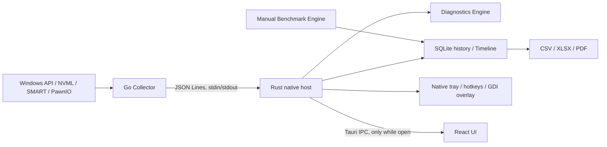

# NEXUS Desktop 1.0 beta

Windows 10/11 x64. React/TypeScript, Tauri 2/Rust, Go и системная Windows SQLite.
Сайт `website/` — отдельный Next.js static export, без зависимости от Desktop.

## Границы модулей

| Подсистема | Расположение и ответственность |
| --- | --- |
| Hardware Collection | `collector/internal/core`: циклы, команды, завершение по EOF |
| Sensor Providers | `collector/internal/platform`: безопасное чтение, кеши и аппаратная деградация |
| Metrics Normalization | `collector/internal/model`, `src/model.ts`: единицы, null, статус, время чтения, TTL |
| History Storage | `src-tauri/src/storage.rs`: Windows winsqlite3, WAL, пакеты, ограниченные запросы, retention |
| Diagnostics Engine | `src-tauri/src/diagnostics_engine.rs`: правила по собранным показаниям, переходы состояний |
| Benchmark Engine | `src-tauri/src/benchmark.rs`: ручные ограниченные проверки, отмена и сохранение результата |
| Report Generator | `src-tauri/src/report.rs`: потоковые таблицы CSV/XLSX, PDF-сводка, обезличивание |
| Tray and Overlay | `src-tauri/src/desktop.rs`, `settings.rs`, `instance.rs`: нативные Windows-службы интерфейса |
| Frontend/UI | `src/App.tsx`, `HistoryChart.tsx`, `Tools.tsx`, `SettingsPage.tsx`: страницы и IPC-клиент |

## Данные и ресурсы

Collector сохраняет протокол `version:1`. Числовая метрика содержит идентификатор,
значение или `null`, единицу, источник и исходную временную отметку. `status`
и `maxAgeMs` добавлены совместимо. Новый кадр не продлевает жизнь кешированного
показания. UI проверяет TTL и возраст транспорта. Причина недоступности видна
пользователю. Старое успешное значение не используется вместо ошибки.

Статический WMI-инвентарь обнаруживается при запуске/ручном обновлении. Быстрые
счётчики обновляются раз в 2 или 5 секунд; SMART, тома и конфигурация сети — в
медленной полосе 10/30/60 секунд. Профиль balanced выбран по умолчанию.
Диагностика не делает дополнительных аппаратных запросов.

SQLite хранит сырые показания за сутки, затем минутные min/max/sum/count.
Взвешенное среднее вычисляется через sum/count. Срок истории настраивается
от 1 до 90 дней, по умолчанию 7. Записи группируются, графики запрашивают
ограниченное число точек выбранных рядов и периода. Пропуски остаются null.
WAL восстанавливается штатной SQLite; повреждённая база сохраняется отдельно.

Основное окно создаётся лениво. При закрытии в фоновой конфигурации уничтожается
его WebView, а Collector, история, трей и GDI-оверлей продолжают работу.
Оверлей не использует WebView, не внедряется в процессы игр и не предоставляет
неподтверждённый FPS. Невидимый оверлей прекращает обновление графики.

## Права и границы безопасности

Desktop и обычный Collector запускаются как текущий пользователь. При отсутствии
доступа к PawnIO/SMART аппаратные показатели сообщают `Недоступно` с причиной.
Пользователь может сам запустить программу с повышением для совместимого источника;
автоматическое повышение всего приложения больше не обязательно.
Изолированный привилегированный broker в этой beta не поставляется.

MSR-политика Alpha сохранена: только поддерживаемые чтения. Запись selector-регистров
AMD, внедрение в игры, обход античитов и скрытая установка драйверов не добавлены.
Проверки не стартуют при автозапуске или обычной диагностике. Файлы диска не
перезаписываются аппаратным тестом. Результат benchmark не считается подтверждением
исправности оборудования.

В `%APPDATA%/local.nexus.desktop` находятся пользовательская история и настройки.
Они не входят в Git. Отчёты по умолчанию скрывают идентификаторы компонентов и
исходные идентифицирующие строки провайдеров; серийные номера, hostname и адреса
из аппаратного инвентаря не копируются в отчёт.

Контракты Collector: [COLLECTOR-1.0.md](COLLECTOR-1.0.md).
Исходный аудит: [AUDIT-1.0.md](AUDIT-1.0.md).
